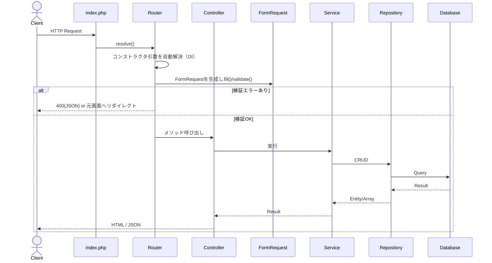

<nuxt-content-wrapper>

このフォルダ（`docs/`）は、`docs/` 配下にある既存ドキュメントを **GhostPHP v4.0 の実装に合わせて更新した版** である。  
既存ドキュメント（v2.x系）は上書きせず、そのまま残してある。旧版と読み比えたい場合は `docs/` 側の同名ファイルを参照すること。

## 1. 全体構成の変更点

旧ドキュメントでは `models/entities`・`models/repositories`・`form_classes`・`interfaces/form_classes` という構成で説明されていたが、v4.0 では以下のようにトップレベルへフラット化されている。

```txt
├─aura
│  ├─database       // DB接続
│  ├─https          // リクエスト・レスポンス管理（HttpRequest / Request / Response / Redirect / Validator）
│  ├─routes         // ルーティング（DI解決・自動バリデーション対応）
│  └─utils
│      ├─commands    // CLI（migrate / seed / importCSV / exportCSV）
│      └─functions   // View補助関数（h() / route() / paginate() など）
├─config             // 設定ファイル（Message / LABEL）
├─controllers        // ★新設: コントローラー層
├─requests           // ★旧 form_classes から改名・移動: FormRequestクラス群
├─interfaces
│  └─repositories    // リポジトリ用インターフェース
├─entities           // ★models/entities から移動
├─repositories        // ★models/repositories から移動
├─services           // サービス層
├─migrations
│  ├─migrate
│  └─seed
├─public
│  └─assets
├─storage
├─logs
└─templates
```

## 2. アーキテクチャの変更点（最重要）

v4.0 最大の変更は **Controller 層の新設** と **Router によるコントローラーメソッドの自動解決** である。



旧ドキュメント（101/102）では `index.php` のルートが直接 `(new UserService)->signin()` のようにサービスを呼び出すクロージャで書かれていたが、v4.0では **`[Controller::class, 'method']` の配列形式** で登録し、`Router` がリフレクションでコントローラーとその依存（Service, Mail など）、さらに引数の `FormRequest` まで自動的に解決する。詳細は [304_router_class.md](304_router_class.md) と [305_controller_class.md](305_controller_class.md) を参照。

## 3. 主な変更点一覧

| 項目 | 旧（docs/） | 新（v4.0） |
|---|---|---|
| リクエスト | `app\aura\https\Request`（1クラスでパス/メソッド取得） | `HttpRequest`（生のHTTP情報取得用）と `Request`（abstract、FormRequestの基底）に分離。[301](301_httprequest_class.md) / [306](306_request_validation.md) |
| バリデーション | `app\aura\utils\Validator` のみ | `app\aura\https\Validator` に移動。FormRequestの `rules()` から使用し、Router が自動実行。`Controller` の `$validator` も `https\Validator` に差し替え。`app\aura\utils\Validator` は `@deprecated`（次のメジャーバージョン v5.0 で削除予定）。[306](306_request_validation.md) / [604](604_validator_class.md) |
| コントローラー | 存在しない（サービスが直接ルートに紐づく） | `app\aura\Controller` 基底クラス＋`controllers/` 配下の各コントローラー。CSRFトークンの発行・検証は Service から Controller に移動。[305](305_controller_class.md) |
| Service | CSRFトークン発行/検証・Session生成・トランザクション管理 | CSRFトークン関連メソッドは `@deprecated`（2026年末に削除予定、Controller側を使用）。トランザクション管理のみが主機能。トランザクションが入れ子に対応（内側のServiceは外側のトランザクションに参加し、確定・取り消しは開始したServiceだけが行う）。[502](502_service_class.md) |
| DataBaseConnect | `new` のたびに新しいDB接続を作成（Serviceのトランザクションが各Repositoryに効いていなかった） | 同一リクエスト内でPDO接続を1本に共有し、Serviceのトランザクションが全Repositoryに効くように。テスト用に `reset()` を追加。[401](401_database_connect.md) |
| Repository | CRUD基本メソッドのみ | `query()`（生SQLで取得）/ `executeAction()`（生SQLで書き込み）/ `bulkInsert()`（複数行を1回のINSERTで登録）を追加。`create()` / `update()` / `bulkInsert()` でカラム名を検証しSQLインジェクションを防止。`findById()` / `update()` / `delete()` の `$id` を `mixed` に変更。DBエラーは Repository で握りつぶさず例外のまま投げ、エラー処理・トランザクションは Service が担う。コンストラクタで `PDO` を注入可能（テスト用）。[402](402_repository_class.md) |
| Response | `setContent()` / `status()` / `header()` が void を返す | 全メソッドが `$this` を返すメソッドチェーン対応。`json()` メソッドを追加。[302](302_response_class.md) |
| Redirect | `to()` が `exit()` で処理を終了。エラーテンプレートのパス（`templates/errors/`）を直書き | `to()` は `exit()` しない（呼び出し元で `return;` する）。`setErrorTemplatesBasePath()` でエラーテンプレートの探索先を設定可能に。`error()` の引数に `int` 型を追加。[303](303_redirect_class.md) |
| Template | テンプレートのパス（`templates/`）を直書き | `setBasePath()` でテンプレートの探索先を設定可能に。`bootstrap.php` で絶対パスを設定し、実行時のカレントディレクトリに依存しない。[503](503_template_class.md) / [203](203_bootstrap.md) |
| Mail | `mb_send_mail()` を直接呼ぶ | PHPMailer + SMTP に変更。`.env` の `SMTP_*` / `MAIL_FROM` 等で設定。[602](602_mail_class.md) |
| File | 単一ファイル（`upfile`固定名）のみ、拡張子はハードコード | 複数ファイルアップロード対応、拡張子は `.env` の `ALLOWED_EXTENSIONS` で設定。戻り値もファイルごとの結果配列に変更。[601](601_file_class.md) |
| CLI | ドキュメント無し | `php ghost migrate` / `seed` / `importCSV` / `exportCSV`。[606](606_cli_commands.md) |
| 依存パッケージ | Composer不要と記載 | Composer必須。`guzzlehttp/guzzle`, `phpmailer/phpmailer`, `tecnickcom/tcpdf`, `vlucas/phpdotenv`（PHP ^8.4）[101](101_framework_requirements.md) |

## 4. このフォルダの読み進め方

基本的には元の `docs/` と同じ並び順・章立てで読み進められる。

1. [101_framework_requirements.md](101_framework_requirements.md) - フレームワーク概要・依存関係・ディレクトリ構成
2. [102_framework_flow.md](102_framework_flow.md) - リクエストが流れる全体像（Controller層を含む）
3. [201](201_app_boot_structure.md) → [203](203_bootstrap.md) - 起動処理
4. [301](301_httprequest_class.md) → [306](306_request_validation.md) - HTTPリクエスト/レスポンス/ルーティング/コントローラー/バリデーション
5. [401](401_database_connect.md) → [402](402_repository_class.md) - DB接続とリポジトリ
6. [501](501_service_template.md) → [503](503_template_class.md) - サービスとテンプレート
7. [601](601_file_class.md) → [606](606_cli_commands.md) - ユーティリティとCLI
8. [700_getting_started.md](700_getting_started.md) - 実装済みの User / Post 機能を最初から最後まで実際のコードで追う実践チュートリアル。まず動かしながら理解したい場合はここから読んでもよい

## 5. v4.2 での変更点

| 項目 | v4.1まで | v4.2 |
|---|---|---|
| ルーティング | `get()` / `post()` のみ。メソッド違いも 404 | `put()` / `patch()` / `delete()` を追加。パスはあるがメソッドが違う場合は 405 と `Allow` ヘッダーを返す。HEAD は GET のルートで処理。[304](304_router_class.md) |
| HttpRequest | `getMethod()` は `REQUEST_METHOD` をそのまま返す | POST ＋ `_method`（PUT / PATCH / DELETE）をそのメソッドとして扱う。本当の PUT / PATCH / DELETE のフォーム形式の本文も読める。クエリ文字列を除いた本文を返す `body()` を追加。[301](301_httprequest_class.md) |
| Controller | `checkToken()` が `$_POST['csrf_token']` を `===` で比較 | `body()` からトークンを読み、`hash_equals()` で比較。URL のクエリ文字列に付けたトークンは受け付けない。[305](305_controller_class.md) |
| サンプルアプリ | 投稿の更新・削除は POST | 更新は PUT、削除は DELETE（フォームに `_method` を付ける）。`_method` を付けずに POST で送ると 405 になる。[201](201_app_boot_structure.md) / [700](700_getting_started.md) |

</nuxt-content-wrapper>
