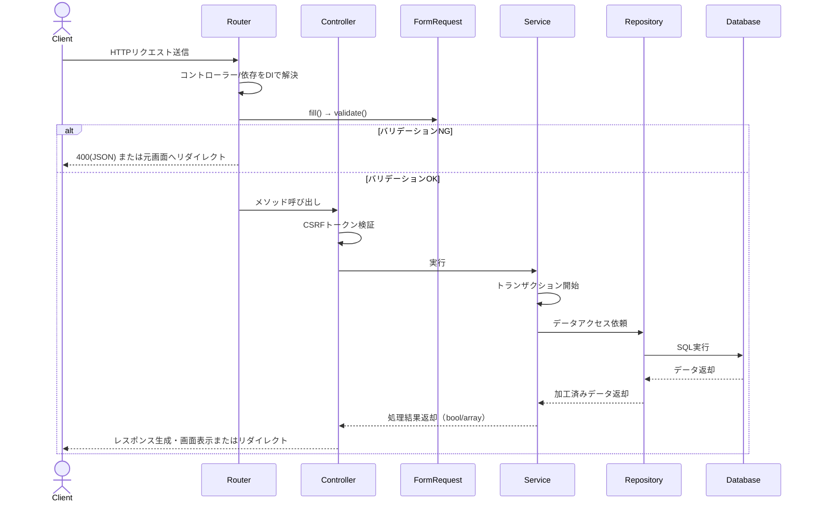

<nuxt-content-wrapper>

GhostPHPは、PHPで構築された軽量なMVCフレームワークであり、ルーティング、コントローラー、サービス、リポジトリの明確な分離を特徴とする。
このドキュメントでは、v4.0における **リクエストがアプリケーションを通過する流れ** を説明する。

> v2.x系との違いは [000_whats_new_v4.md](000_whats_new_v4.md) を参照。最大の違いは **Controller層の新設** と **Routerによるコントローラー/FormRequestの自動解決** である。

## 1. ルーティング

ルーティングは、HTTPリクエストをアプリケーションの適切なコントローラーにマッピングする役割を担う。

### 主要コンポーネント

- **Router クラス** (`aura/routes/Router.php`): HTTPリクエストのルーティングと、コントローラー・FormRequestの自動解決を行う。
- **HttpRequest クラス** (`aura/https/HttpRequest.php`): 生のHTTPリクエスト（パス・メソッド・入力値・ファイル）を表す。

### 機能

- GETとPOSTリクエストの登録
- パスとコールバック（クロージャ、または `[Controller::class, 'method']`）のマッピング
- 現在のリクエストの解決と、対応するコールバック／コントローラーメソッドの実行
- コントローラーのコンストラクタ引数、およびメソッド引数の `FormRequest` を型情報から自動解決（DI）

### 使用例（`index.php`）

```php
// index.phpでのルート定義
$app = new App();

$app->router->get('signin',  [UserController::class, 'showSignInForm']);
$app->router->get('signup',  [UserController::class, 'showSignUpForm']);

$app->router->post('signin',  [UserController::class, 'signin']);
$app->router->post('signup',  [UserController::class, 'signup']);

// 単純なクロージャも従来通り登録できる
$app->router->get('', function () { include "templates/welcome.php"; });

$app->run();
```

### 処理フロー

1. `App` クラスが `HttpRequest` と `Router` のインスタンスを初期化
2. `index.php` でルートが定義される
3. `$app->run()` が呼び出されると、`Router::resolve()` メソッドが現在のリクエストを解決
4. コールバックが `[Controller::class, 'method']` の形式の場合、`Router` は以下を自動で行う：
   1. コントローラーのコンストラクタ引数（Service, Mail など）をリフレクションで解決してインスタンス化
   2. メソッド引数の型を調べ、組み込み型（`int`/`string`等）はリクエストの `input()` から、`Request` を継承したクラス（FormRequest）はリクエストデータを `fill()` してから `validate()` を実行
   3. 検証エラーがあれば、JSONリクエストの場合は400を返し、通常のフォームリクエストの場合はエラーをセッションに積んでリファラへリダイレクトし、コントローラーメソッドは呼び出さない
   4. 検証を通過した場合のみ、コントローラーメソッドを実行

## 2. コントローラー（v4.0で新設）

コントローラーは、HTTPリクエストを受け取り、適切なサービスを呼び出し、レスポンス（テンプレート描画・リダイレクト等）を行う役割を担う。**ビジネスロジックは持たない。**

### 主要コンポーネント

- **Controller 基底クラス** (`aura/Controller.php`): CSRFトークンの発行・検証など、すべてのコントローラーの共通機能を提供
- **UserController** (`controllers/UserController.php`): ユーザー関連のリクエストを処理
- **PostController** (`controllers/PostController.php`): 投稿関連のリクエストを処理

### 機能

- Serviceの呼び出しとテンプレート描画・リダイレクトの実行
- CSRFトークンの生成と検証（`setToken()` / `checkToken()`）
- コンストラクタで必要なService/utilityをDIで受け取る

### 使用例

```php
class UserController extends Controller {
    private UserService $home_service;
    private Mail $mail;

    public function __construct(UserService $UserService, Mail $mail) {
        parent::__construct();
        $this->home_service = $UserService;
        $this->mail = $mail;
    }

    public function signup(UserRequest $user_request): void {
        if (!$this->checkToken('signup')) {
            return;
        }

        if (!$this->home_service->signup($user_request)) {
            Redirect::to('signup');
            return;
        }

        Redirect::to('index');
    }
}
```

`UserRequest $user_request` は Router がすでに `fill()` と `validate()` を済ませた状態で渡してくる（検証NGならこのメソッド自体は呼ばれない）。

### 処理フロー

1. ルーターがリクエストをコントローラーのメソッドにマッピングし、FormRequestの検証を実行
2. コントローラーがCSRFトークンを検証
3. コントローラーが適切なサービスメソッドを呼び出す
4. コントローラーがテンプレートを描画するか、リダイレクトを実行

## 3. FormRequest（バリデーション）

Requestは入力データの取得と検証を1つのクラスに集約する。Laravel の FormRequest に近い設計。詳細は [306_request_validation.md](306_request_validation.md)。

```php
class UserRequest extends Request {
    public int $id;
    public string $name;
    public string $email;
    public string $password;
    public string $password_conf;

    protected function rules(Validator $validator): void {
        $validator->required($this->email, 'email');
        $validator->mailFormat($this->email, 'email');
        $validator->passwordFormat($this->password, 'password');

        if (!empty($this->password_conf)) {
            $validator->passwordConfirm($this->password, $this->password_conf);
        }
    }
}
```

## 4. サービス

サービスは、アプリケーションのビジネスロジックを実装し、コントローラーとリポジトリの間の仲介役を果たす。

### 主要コンポーネント

- **Service 基底クラス** (`aura/Service.php`): トランザクション管理などアプリ全体で共通する機能を提供
- **UserService** (`services/UserService.php`): ユーザー関連のビジネスロジックを実装
- **PostService** (`services/PostService.php`): 投稿関連のビジネスロジックを実装

### 使用例

```php
class PostService extends Service {
    public function __construct(
        private Logger $logger,
        private PostRepository $postRepository,
        private UserRepository $userRepository,
        private Session $session
    ) {
        parent::__construct();
    }

    public function create(PostRequest $postRequest): bool {
        $this->beginTransaction();

        try {
            $post = $this->makePost($postRequest);
            $result = $this->postRepository->createPost($post);

            if (!$result) {
                throw new \Exception('Post creation failed.');
            }

            $this->commit();
            return true;
        } catch (\Exception $e) {
            $this->rollBack();
            $this->logger->error($e->getMessage());
            return false;
        }
    }

    public function makePost(PostRequest $postRequest): Post {
        $post = new Post();
        if (!empty($postRequest->input('id'))) {
            $post->setId($postRequest->input('id'));
        }
        $post->setUserId($postRequest->input('user_id'));
        $post->setTitle($postRequest->input('title'));
        $post->setBody($postRequest->input('body'));
        return $post;
    }
}
```

サービスのコンストラクタ引数（`Logger`, `PostRepository`, `UserRepository`, `Session` など）も、Routerがコントローラーを生成する際と同じ仕組みでDI解決される（コントローラー → サービス → …と依存が連鎖してもRouterが再帰的に解決する）。

### 処理フロー

1. コントローラーがサービスメソッドを呼び出す（FormRequestを渡す）
2. サービスがトランザクションを開始
3. サービスがFormRequestからEntityを組み立てる
4. サービスが必要に応じてリポジトリを呼び出す
5. サービスが結果に基づいてコミット／ロールバックし、真偽値や配列を返す

## 5. リポジトリ

リポジトリは、データベースとのやり取りを担当し、Entityの永続化と取得を行う。

### 主要コンポーネント

- **Repository 基底クラス** (`aura/Repository.php`): すべてのリポジトリの基本CRUD機能を提供
- **UserRepository** (`repositories/UserRepository.php`) / **IUserRepository** (`interfaces/repositories/IUserRepository.php`)
- **PostRepository** (`repositories/PostRepository.php`) / **IPostRepository** (`interfaces/repositories/IPostRepository.php`)

### 使用例

```php
class PostRepository extends Repository implements IPostRepository {
    public function __construct(?PDO $pdo = null) {
        parent::__construct('posts', $pdo);
    }

    public function createPost(Post $post): bool {
        $data = [
            'title' => $post->getTitle(),
            'body' => $post->getBody(),
            'user_id' => $post->getUserId(),
        ];
        return parent::create($data);
    }
}
```

`?PDO $pdo = null` を受け取れるようにしておくと、テスト時に外部からモックのPDOを注入できる。

### 処理フロー

1. サービスがリポジトリメソッドを呼び出す
2. リポジトリがデータベース操作を実行
3. リポジトリが結果をサービスに返す

## 6. 全体のフロー



### 具体的な例：ユーザーサインアップ

1. **ルーティング**:
   - クライアントが `/signup` にPOSTリクエストを送信
   - `Router` が `UserController::signup(UserRequest $user_request)` を解決
   - Routerが `UserController` を生成する際、その依存 `UserService` と `Mail` も再帰的に解決
   - Routerが `UserRequest` を生成し、`fill()` してから `validate()` を実行

2. **コントローラー**:
   - 検証NGならこの時点でリダイレクト済み・処理終了。検証OKなら `UserController::signup()` が呼ばれる
   - `checkToken('signup')` でCSRFトークンを検証
   - `UserService::signup()` を呼び出す

3. **サービス**:
   - トランザクションを開始
   - `UserRequest` から `UserEntity` を組み立てる（`makeUser()`）
   - `UserRepository::signup()` を呼び出す

4. **リポジトリ**:
   - `UserRepository::signup()` がユーザーデータをデータベースに保存
   - パスワードをハッシュ化
   - 基底クラスの `create()` メソッドを使用してSQLを実行

5. **サービス（続き）／コントローラー**:
   - 結果に基づいてトランザクションをコミットまたはロールバック
   - コントローラーが成功時にユーザーをインデックスページへリダイレクト

この流れにより、関心事の明確な分離が実現され、コードの保守性と拡張性が向上する。

</nuxt-content-wrapper>
